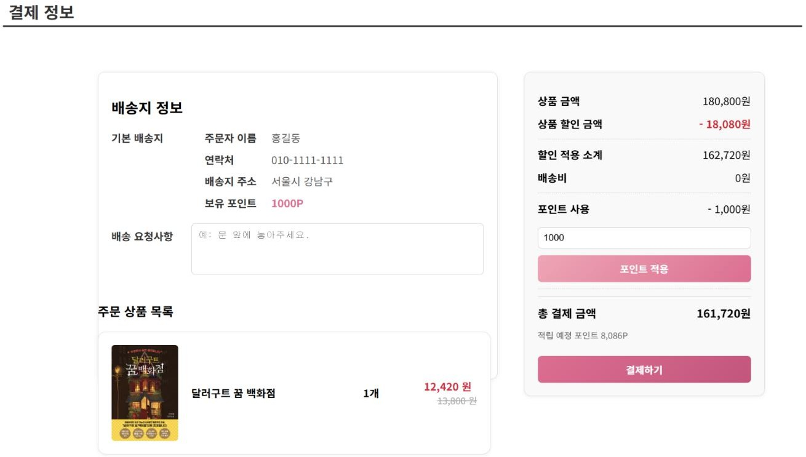
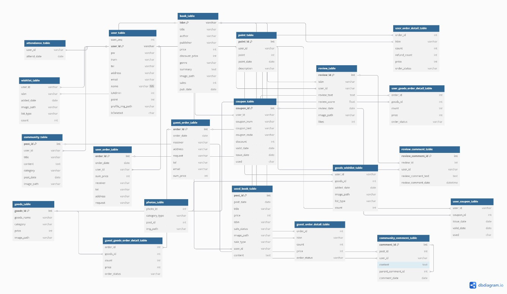

# DasiBom - 온라인 도서 커머스 웹 사이트

도서 검색, 리뷰, 장바구니, 중고 거래, 채팅 기능을 포함한 온라인 서점 웹 사이트입니다.
도서 탐색부터 구매까지를 하나의 사이트에서 처리하고, 전자상거래의 주문과 결제 구조를 직접 구현해 보기 위해 기획했습니다.

- GitHub: https://github.com/kimseoyeon6465/Dasibom
- YouTube: https://youtu.be/BgfCU3VaJDs
- 포트폴리오: https://github.com/kimseoyeon6465/Portfolio

## 프로젝트 개요

| 항목 | 내용 |
|---|---|
| 기간 | 2025.06.10 ~ 2025.06.30 (약 3주) |
| 인원 | 5명 (팀 프로젝트) |
| 담당 | 회원/비회원 장바구니, 주문, 결제 서비스 / 전체 DB 설계 (DB 담당) |

## 기술

Java 11, Spring MVC 5.3, MyBatis, Oracle, JSP, JavaScript, jQuery, 포트원(구 아임포트) SDK 카카오페이 테스트 결제, Tomcat 8.5

## 담당

- 회원/비회원 장바구니, 주문, 결제 전 과정 설계 및 구현
- 도서 10% 할인가, 배송비(5만원 미만 3,000원), 포인트 사용과 5% 적립을 반영한 결제 금액 계산
- 포트원 SDK를 이용한 카카오페이 결제창 호출, 결제 성공 콜백 처리 후 주문 저장
- 회원 주문 테이블 3개와 비회원 주문 테이블 3개를 분리하는 DB 설계
- DB 담당: 전체 테이블 설계, 참조 방식과 변수명 기준 정리

## 핵심 구현

- **결제 금액 계산과 결제 요청:** 결제하기를 누르면 포인트 적용 계산을 먼저 실행하고, 확정된 최종 금액으로 카카오페이 결제창을 호출합니다.
- **결제 성공 후 주문 저장:** 결제 성공 응답을 받은 뒤에만 주문, 주문 상세, 포인트 차감과 적립, 장바구니 비우기를 처리합니다. 주문은 '결제완료' 상태로 저장됩니다.
- **회원/비회원 주문 처리:** 비회원 주문번호는 시퀀스로 발급하고, 결제 후 이메일로 주문 내역을 조회합니다.
- **주문 테이블 구조:** 주문, 주문 상세(도서), 주문 상세(굿즈) 3단으로 나누어 한 주문에 도서와 굿즈를 함께 담습니다.

## 트러블슈팅

| 문제 상황 | 원인 분석과 시도 | 해결 결과 |
|---|---|---|
| 카카오페이 테스트 결제 중, 화면에는 10% 할인가가 표시되는데 결제창에는 정가 합계가 요청됨 | 결제 요청, 금액 계산, DB 저장 순서로 점검. 최종 금액이 확정되기 전에 결제 요청이 나가던 시점 문제 | 포인트 계산을 먼저 실행하고 확정된 금액으로만 결제 요청. 카카오페이 결제 금액과 DB 저장 금액 모두 할인가 합계로 일치 |

## 화면과 ERD

## 성과 및 아쉬운 점

- 회원/비회원 주문, 결제, 주문 조회를 구현했고 테이블은 회원용 3개, 비회원용 3개로 분리했습니다.
- 5명이 만든 기능을 병합 오류 없이 합쳐 완성했습니다. DB 담당으로 테이블 구조와 변수명 기준을 정리해 팀에 공유했습니다.
- 결제 금액은 화면에서 계산해 전달하며, 서버에서 다시 검증하는 로직은 구현하지 못했습니다.
- 결제는 성공했지만 주문 저장이 실패한 경우의 처리는 구현하지 못했습니다.
- 보완 계획: Naver Pay, Toss Pay 추가 / 취소, 환불까지 포함한 주문 상태 정의 / 비회원 본인 확인 강화

## 실행 환경

- Java 11, Maven, Tomcat 8.5
- Oracle (`root-context.xml`의 접속 정보를 로컬 DB에 맞게 수정, 기본값 `127.0.0.1:1521:xe`)
- 카카오페이 결제는 포트원 테스트 모드 기준이며, 가맹점 식별코드는 본인 포트원 계정 값으로 교체가 필요합니다.
- 테이블 생성 스크립트는 저장소에 포함하지 않았고, ERD 이미지를 참고해 구성합니다.
